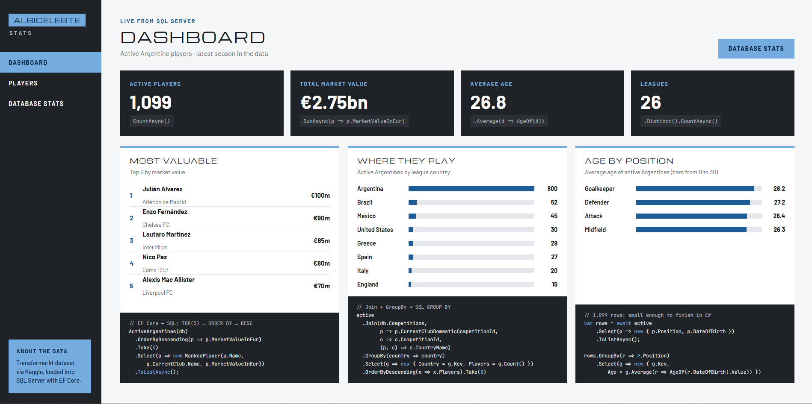
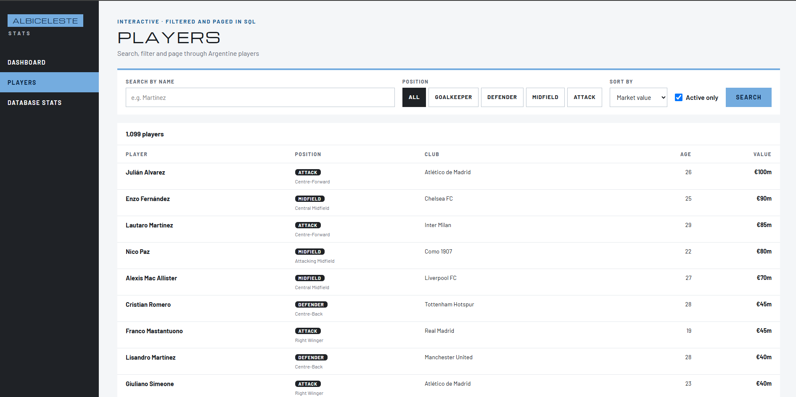
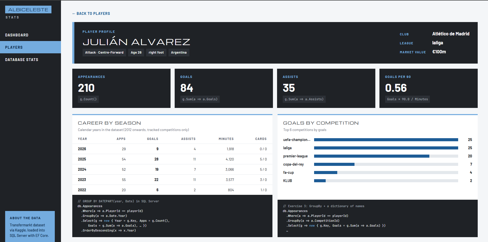

# ⚽ Albiceleste Web

A full-stack .NET web app about Argentine football players, built to learn **Entity Framework Core** and **Blazor**, on real Transfermarkt data: **50,149 players** and **1.9 million match appearances** in SQL Server.

Every screen shows the LINQ query that powers it.





---

## 🧰 Tech stack

- **C# / .NET 10 (LTS)**
- **Entity Framework Core 10** (code first, migrations, LINQ to SQL)
- **SQL Server 2025 Express**
- **Blazor Web App** (static server rendering + Interactive Server)
- **CsvHelper** and **SqlBulkCopy** for the data import
- **xUnit** integration tests against a real test database
- **JetBrains Rider**

## ✨ Features

| Page | What it shows | Techniques |
|---|---|---|
| **Dashboard** | 4 headline numbers, most valuable players, where they play, age by position | Service layer, reusable components, `GroupBy` and `Join` in SQL, streaming rendering |
| **Players** | Search, position filters, sorting, paging | Interactive Server, `IQueryable` + `Expression` filters (`WhereIf`), `OFFSET`/`FETCH` paging with a stable tie-breaker |
| **Player profile** | Club, league, career totals, career by season, goals by competition | Route parameters, `SingleOrDefault` lookups, `GROUP BY` over 1.9M rows, "not found" state |
| **Database stats** | Row counts per table | `IDbContextFactory`, async EF Core |

## 🏗️ Architecture

```
AlbicelesteWeb/
├── AlbicelesteWeb.Data        Entities, DbContext, migrations (EF Core)
├── AlbicelesteWeb.Importer    Console app: CSV → SQL Server (CsvHelper, EF Core, SqlBulkCopy)
├── AlbicelesteWeb.Web         Blazor app: pages, components, services
├── AlbicelesteWeb.Playground  One file per lesson of EF Core experiments (SQL logging)
└── AlbicelesteWeb.Tests       xUnit tests for the services, on a throwaway test database
```

**Data model:** `Competition` 1—* `Club` 1—* `Player` 1—* `Appearance`, with foreign keys enforced by the database.

## 📏 Measured results

| What | Before | After |
|---|---|---|
| Counting Argentines: `ToList().Count(…)` vs `Count(…)` in SQL | 445 ms | **21 ms** |
| Inserting 1.9M appearances: EF Core in chunks vs `SqlBulkCopy` | 81.7 s | **17.6 s** |
| Serie A appearances since 2023: no index vs `(CompetitionId, Date)` index | 145 ms | **3 ms** |
| N+1 queries vs one projected query (39 clubs) | 40 queries | **1 query** |

## 🧠 What I learned

| Lesson | Topic |
|---|---|
| E1 | DbContext, entities, conventions, Fluent API, code-first migrations |
| E2 | Change tracking, Unit of Work, `SaveChanges` transactions, idempotent imports |
| E3 | The SQL behind LINQ (`ToQueryString`, logging), translation limits, client evaluation, projection, `AsNoTracking` |
| E4 | Foreign keys, navigation properties, `Include`, relationship fix-up, the N+1 problem |
| E5 | Bulk import (`SqlBulkCopy`), partial loads and verification, column sizes, indexes, seek vs scan |
| B1 | Blazor components, render modes, dependency injection, configuration, `IDbContextFactory` |
| B2 | Service layer, reusable components, CSS isolation, responsive layout |
| B3 | Interactive pages, `Expression` vs `Func`, paging in SQL, prerendering, collations |
| B4 | Route parameters and constraints, `OnParametersSetAsync`, career statistics |
| B5 | Integration tests with a real test database, polish |

### Things the data taught me
- **An inner join silently drops rows, but a foreign key won't let bad links in.** Colombia's league (`COL1`) is missing from the competitions file: an in-memory join quietly dropped its players, while the database's foreign keys made the importer report it.
- **Batched imports aren't all-or-nothing.** A stopped import left exactly 670,000 of 1.9M rows. Now the importer verifies the row count after every run.
- **`Func` vs `Expression` matters.** The same lambda as a `Func` downloads the whole table; as an `Expression` it becomes a SQL `WHERE`.
- **SQL Server compares text with its own rules.** Searches are case-insensitive in the database, unlike C#.

## 🚀 Run it locally

**Prerequisites:** .NET 10 SDK, SQL Server Express (instance `SQLEXPRESS`), the EF Core tools:
```bash
dotnet tool install --global dotnet-ef --version 10.0.15
```

1. **Get the data.** Download the [Transfermarkt dataset from Kaggle](https://www.kaggle.com/datasets/davidcariboo/player-scores) and copy `competitions.csv`, `clubs.csv`, `players.csv` and `appearances.csv` into `AlbicelesteWeb.Importer/data/`. The data isn't included in this repo.
2. **Create the database:**
   ```bash
   dotnet ef database update --project AlbicelesteWeb.Data
   ```
3. **Import the data:**
   ```bash
   dotnet run --project AlbicelesteWeb.Importer
   ```
4. **Run the web app:**
   ```bash
   dotnet run --project AlbicelesteWeb.Web
   ```
5. **Run the tests** (they create and delete their own `Albiceleste_Tests` database):
   ```bash
   dotnet test
   ```

The local connection string uses Windows authentication, so there is no password anywhere in the repo.

## 🙏 Credits

Data: [transfermarkt-datasets](https://github.com/dcaribou/transfermarkt-datasets), built from [Transfermarkt](https://www.transfermarkt.com). Used for learning purposes only.
